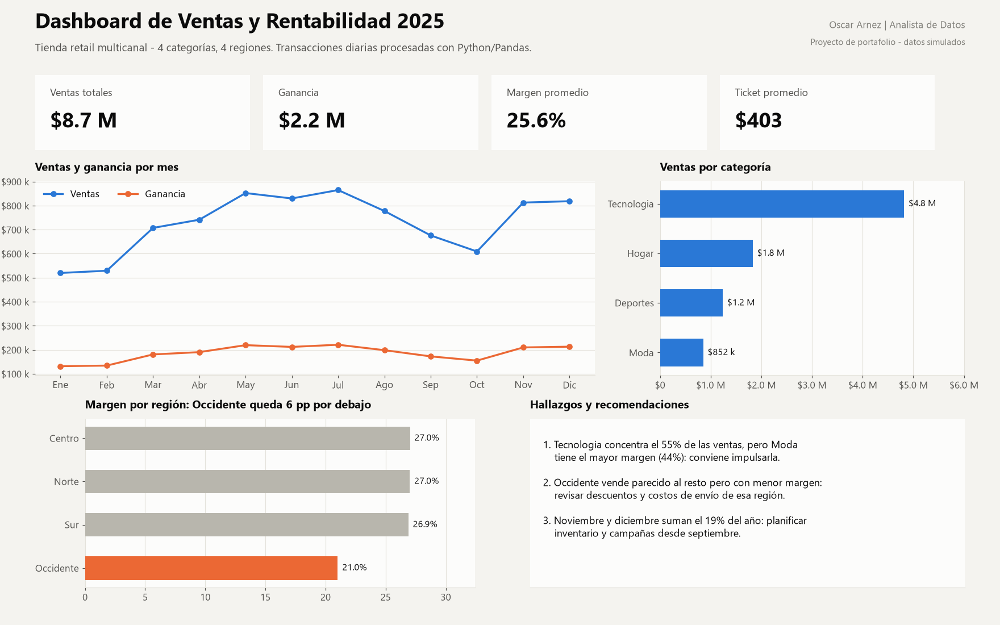

# 01 · Dashboard de Ventas y Rentabilidad (Retail)

> **Pregunta de negocio:** ¿qué categorías, regiones y meses generan la ganancia de una tienda retail y dónde se está perdiendo margen?



## Contexto

Una tienda retail multicanal vende 4 categorías en 4 regiones. Gerencia ve las ventas en planillas separadas
y no tiene una vista única de **ventas + ganancia + margen**. El objetivo es consolidar las 21.680 transacciones de 2025
en un tablero que responda tres preguntas: qué vende más, qué deja más ganancia y cuándo se concentra la demanda.

## Datos

| Archivo | Filas | Columnas |
|---|---|---|
| `data/ventas_retail_2025.csv` | 21.680 | fecha, categoria, region, unidades, venta, ganancia |

Datos **simulados** con `src/generar_datos.py` (semilla fija, reproducible). La simulación incluye estacionalidad
(pico de mitad de año y campañas de fin de año) y una región con más descuentos, para que el análisis tenga algo real que encontrar.

## Enfoque

1. **Carga y tipado** con Pandas (fechas, mes).
2. **Agregaciones** por mes, categoría y región: ventas, ganancia y margen (`ganancia / venta`).
3. **KPIs**: ventas totales, ganancia, margen promedio y ticket promedio.
4. **Visualización** con Matplotlib: una sola página con jerarquía clara (KPIs arriba, tendencia, cortes y hallazgos).
5. Los textos del tablero se **calculan desde los datos** (no están escritos a mano), así que se actualizan si cambian los datos.

## Resultados

| Indicador | Valor |
|---|---|
| Ventas 2025 | $8,74 M |
| Ganancia | $2,24 M |
| Margen promedio | 25,6% |
| Ticket promedio | $403 |

## Hallazgos y recomendaciones

1. **Tecnología concentra el 55% de las ventas, pero Moda tiene el mayor margen (44%).** Empujar Moda con más visibilidad
   en la tienda online y en combos sube la ganancia sin depender de más volumen.
2. **Occidente tiene un margen 6 puntos más bajo que el resto** vendiendo un volumen parecido. Hay que revisar sus descuentos
   y el costo de envío de esa región antes de abrir más puntos de venta ahí.
3. **Julio fue el mejor mes y enero el más bajo.** Conviene planificar inventario y promociones en función de esa curva, no con un presupuesto plano mensual.

Las tablas de soporte están en `outputs/`: `resumen_mensual.csv`, `resumen_categoria.csv` y `resumen_region.csv`. Las métricas están en `metricas.json`.

## Cómo ejecutarlo

```bash
pip install -r ../requirements.txt
python src/generar_datos.py   # crea data/ventas_retail_2025.csv
python src/analisis.py        # crea outputs/dashboard_ventas.png y los resúmenes
```

## Estructura

```
01-dashboard-ventas-retail/
├── data/ventas_retail_2025.csv
├── outputs/            dashboard, resúmenes CSV, metricas.json
└── src/
    ├── generar_datos.py
    ├── analisis.py
    └── estilo.py       paleta y componentes de gráficos (KPIs, paneles)
```

**Tecnologías:** Python · Pandas · Matplotlib
