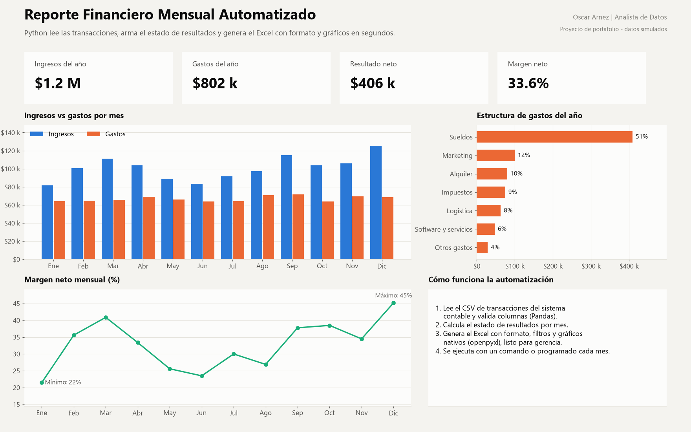

# 02 · Automatización del Reporte Financiero Mensual (Python + Excel)

> **Pregunta de negocio:** ¿cómo dejar de armar a mano, cada mes, el estado de resultados en Excel?



## Contexto

En muchas pymes el área contable exporta las transacciones del sistema y pasa horas copiando, sumando y dando formato
a un Excel para gerencia. Este proyecto convierte ese proceso en **un solo comando**. El script lee el CSV, valida los datos,
calcula el estado de resultados y entrega un Excel con formato profesional y gráficos nativos (editables en Excel).

## Qué genera

`outputs/reporte_financiero_2025.xlsx`, con 3 hojas:

| Hoja | Contenido |
|---|---|
| **Resumen mensual** | Ingresos, gastos, resultado y margen % por mes, más 2 gráficos nativos de Excel |
| **Estado de resultados** | Cada cuenta × 12 meses, con total anual |
| **Transacciones** | Detalle original con filtros |

Todas las hojas tienen encabezados con color, formato de miles, paneles inmovilizados y autofiltro.

## Datos

`data/transacciones_2025.csv`: 1.302 movimientos con las columnas `fecha, tipo (Ingreso/Gasto), cuenta, monto`.
Son datos **simulados** con `src/generar_datos.py`, que imita una pyme de servicios con crecimiento mensual y campañas de marketing en marzo y septiembre.

El script **valida la entrada** antes de procesar. Si faltan columnas o el campo `tipo` tiene valores desconocidos, avisa con un mensaje claro en vez de generar un reporte incorrecto.

## Resultados del año

| Indicador | Valor |
|---|---|
| Ingresos | $1,21 M |
| Gastos | $0,80 M |
| Resultado neto | $0,41 M |
| Margen neto | 33,6% |
| Margen más bajo / más alto | enero 21,5% / diciembre 45,2% |
| Gasto principal | Sueldos (51% del gasto) |

El margen sube durante el año porque los ingresos crecen mientras los costos fijos (sueldos y alquiler) se mantienen. Los picos de gasto de marzo y septiembre corresponden a campañas de marketing.

## Cómo usarlo con tus datos

```bash
pip install -r ../requirements.txt
python src/generar_datos.py                       # opcional: datos de ejemplo
python src/generar_reporte.py                     # usa data/transacciones_2025.csv
python src/generar_reporte.py --entrada mis_movimientos.csv --salida reporte_noviembre.xlsx
```

Para que corra solo cada mes, se puede programar en el Programador de tareas de Windows o con `cron` en Linux.

## Estructura

```
02-reporte-financiero-automatizado/
├── data/transacciones_2025.csv
├── outputs/   reporte_financiero_2025.xlsx, dashboard_financiero.png, metricas.json
└── src/
    ├── generar_datos.py
    ├── generar_reporte.py   CLI: validar -> calcular -> Excel -> dashboard
    └── estilo.py
```

**Tecnologías:** Python · Pandas · openpyxl (formato y gráficos de Excel) · Matplotlib · argparse
