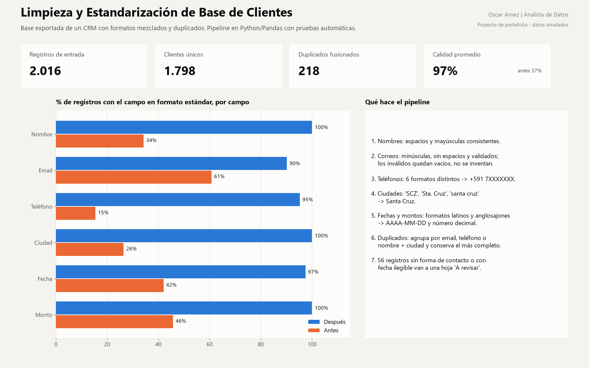

# 03 · Limpieza y Estandarización de una Base de Clientes

> **Pregunta de negocio:** la base de clientes exportada del CRM tiene duplicados y formatos mezclados.
> ¿Cómo dejarla lista para campañas, facturación o migración a otro sistema sin perder información?



## Contexto

Es uno de los pedidos más comunes en análisis de datos. Llega una base cargada por distintas personas y formularios,
con `SCZ`, `Sta. Cruz` y `santa cruz` en la misma columna, teléfonos en 6 formatos, montos con coma o con punto decimal
y el mismo cliente cargado dos veces. Este proyecto resuelve el problema con un **pipeline reproducible y probado**,
no con arreglos a mano que hay que repetir cada vez.

## Datos de entrada

`data/clientes_crudo.csv`: 2.016 registros (1.800 clientes reales + 216 duplicados con variaciones), generados por
`src/generar_datos.py` con estos problemas introducidos a propósito:

| Campo | Problemas |
|---|---|
| nombre | MAYÚSCULAS, minúsculas, espacios dobles y al inicio o al final |
| email | mayúsculas, espacios, sin `@`, sin dominio, vacíos |
| telefono | `+591 71234567`, `71234567`, `591-712-34567`, `(591) 7123 4567`, `7123-4567`, vacíos |
| ciudad | 3 a 5 formas de escribir cada ciudad |
| fecha_registro | `2024-03-05`, `05/03/2024`, `05.03.2024`, `pendiente` |
| monto_compras | `1250.50`, `1,250.50`, `1.250,50`, `Bs 1.250,50` |

## Enfoque

`src/limpieza.py` contiene una función pura por cada regla. Si una función no puede interpretar un valor, devuelve vacío: **nunca inventa datos**.

1. **Estandarizar** cada campo: nombre propio, correo validado con expresión regular, teléfono a `+591 XXXXXXXX`, ciudad a un catálogo, fecha a ISO y monto a decimal.
2. **Deduplicar con union-find.** Dos registros son el mismo cliente si comparten email, teléfono o nombre + ciudad. Los vínculos encadenados también cuentan: si A comparte email con B y B comparte teléfono con C, A, B y C se fusionan.
3. **Fusionar** cada grupo. Se conserva el registro más completo y sus vacíos se rellenan con los datos de los duplicados.
4. **Separar lo dudoso.** Los clientes sin ningún contacto válido o con fecha ilegible van a la hoja *A revisar*, para que los revise una persona.
5. **Medir la calidad antes y después.** Para cada campo se calcula el % de registros que ya cumplen el formato estándar.

## Resultados

| Indicador | Valor |
|---|---|
| Registros de entrada | 2.016 |
| Clientes únicos | 1.798 |
| Duplicados fusionados | 218 |
| Calidad promedio | **37% → 97%** |
| Registros a revisar | 56 |

| Campo | Antes | Después |
|---|---|---|
| Nombre | 34% | 100% |
| Email | 61% | 90%* |
| Teléfono | 15% | 95%* |
| Ciudad | 26% | 100% |
| Fecha | 42% | 97%* |
| Monto | 46% | 100% |

\* Lo que falta para llegar al 100% son correos o teléfonos que venían vacíos o eran inválidos en origen. No se completan con datos inventados: quedan señalados para revisión.

**Validación:** la base se generó con 1.800 clientes y el pipeline encontró 1.798. Los 2 casos fusionados de más son clientes distintos que, por azar, recibieron el mismo correo en la simulación. Es la misma decisión que tomaría un CRM real.

## Pruebas automáticas

37 pruebas con `pytest` cubren cada formato de teléfono, fecha y monto, además de la fusión encadenada de duplicados. También corren en GitHub Actions con cada cambio.

```bash
pytest tests -q
```

## Entregables (`outputs/`)

- `clientes_limpio.csv`: base final, un registro por cliente.
- `reporte_limpieza.xlsx`: hojas *Resumen*, *Clientes limpios*, *Duplicados fusionados* (qué IDs se unieron) y *A revisar*.
- `calidad_antes_despues.png` y `metricas.json`.

## Cómo ejecutarlo

```bash
pip install -r ../requirements.txt
python src/generar_datos.py
python src/pipeline.py                          # o: --entrada otra_base.csv
```

**Tecnologías:** Python · Pandas · expresiones regulares · union-find · pytest · openpyxl
