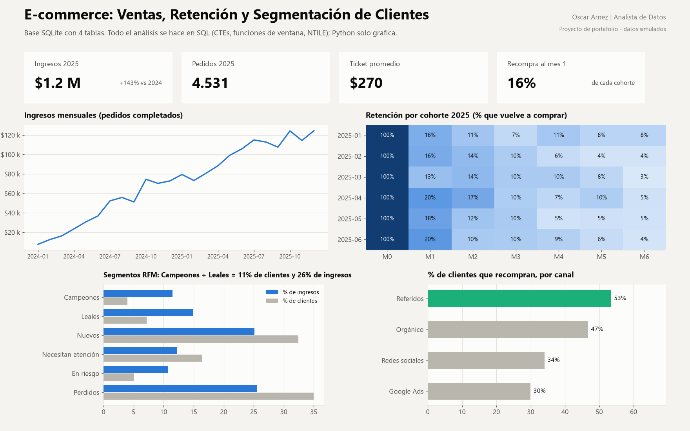

# 04 · Análisis SQL de un E-commerce: Ventas, Cohortes y Segmentación RFM

> **Pregunta de negocio:** ¿el negocio crece porque los clientes vuelven o solo porque entran clientes nuevos?
> ¿Quiénes son los clientes más valiosos y qué canal trae a los que se quedan?



## Contexto

Una tienda online de 6 categorías guarda sus datos en una base relacional. **Todo el análisis está en SQL**
(CTEs, funciones de ventana, `NTILE`, `RANK`, `LAG`) y Python solo ejecuta las consultas y grafica. Las consultas se
pueden llevar sin cambios a PostgreSQL o MySQL (excepto las funciones de fecha propias de SQLite).

## Modelo de datos (`data/ecommerce.db`, SQLite)

```
clientes (4.000)          pedidos (6.965)                detalle_pedido (17.479)      productos (60)
──────────────            ───────────────                ──────────────────────        ─────────────
id_cliente  PK  ◄──────── id_cliente  FK                 id_pedido   FK ──► pedidos    id_producto PK
fecha_alta                id_pedido   PK ◄────────────── id_producto FK ──────────►    nombre
ciudad                    fecha                          cantidad                      categoria
canal                     estado (completado/            precio_unitario               precio
                                  cancelado/devuelto)
```

Datos **simulados** con `src/generar_datos.py`. La base de clientes crece en el tiempo, cada canal tiene una tasa de recompra distinta, la popularidad de los productos es desigual (distribución de Pareto) y hay descuentos ocasionales.

## Consultas (`sql/`)

| Archivo | Qué responde | Técnicas |
|---|---|---|
| `01_kpis_mensuales.sql` | Ingresos, pedidos, clientes activos, ticket y variación mensual | CTE, `LAG()` |
| `02_top_productos.sql` | Top 3 productos por categoría y su peso dentro de la categoría | `RANK() OVER (PARTITION BY)`, `SUM() OVER` |
| `03_cohortes_retencion.sql` | % de cada cohorte que vuelve a comprar N meses después | 4 CTEs encadenadas, aritmética de meses |
| `04_segmentacion_rfm.sql` | Segmentos Campeones, Leales, Nuevos, En riesgo, Perdidos, etc. | `NTILE(5)`, `CASE`, % del total con ventana |
| `05_recompra_por_canal.sql` | Recompra y valor de vida (LTV) por canal de adquisición | agregación condicional |

Ejemplo, la segmentación RFM:

```sql
puntaje AS (
    SELECT *,
           NTILE(5) OVER (ORDER BY recencia_dias DESC) AS r,
           CASE WHEN frecuencia = 1 THEN 1 WHEN frecuencia = 2 THEN 2 WHEN frecuencia = 3 THEN 3
                WHEN frecuencia <= 5 THEN 4 ELSE 5 END   AS f,
           NTILE(5) OVER (ORDER BY monto)              AS m
    FROM base
)
```

> Decisión de diseño: la **frecuencia** se puntúa con umbrales fijos y no con `NTILE`, porque la mayoría de los clientes
> compra una sola vez y `NTILE` repartiría esos empates al azar entre puntajes distintos.

## Resultados

| Indicador | Valor |
|---|---|
| Ingresos 2025 | $1,22 M (+143% vs 2024) |
| Pedidos 2025 | 4.531 |
| Ticket promedio | $270 |
| Retención promedio al mes 1 / mes 3 | 16% / 11% |
| Campeones + Leales | 11% de los clientes → **26% de los ingresos** |
| Recompra por canal | Referidos 53% · Orgánico 47% · Redes sociales 34% · Google Ads 30% |

## Hallazgos y recomendaciones

1. **El crecimiento depende de clientes nuevos.** Solo 16% de cada cohorte vuelve al mes siguiente y 11% al tercer mes.
   Un flujo de correos de segunda compra (días 7, 21 y 45) es la palanca más barata para subir ingresos.
2. **Un Campeón vale 4 veces más que un cliente Perdido** ($1.315 frente a $332 de ingreso acumulado). Hay 190 clientes
   **En riesgo** (compraban seguido y dejaron de hacerlo) que conviene contactar ya con una oferta personalizada.
3. **Los clientes referidos recompran casi el doble que los de Google Ads** (53% frente a 30%). Conviene redirigir parte del
   presupuesto de anuncios a un programa de referidos.
4. **Las ventas se concentran en pocos productos**: en Belleza, la crema facial representa el 77% de los ingresos de la
   categoría, un riesgo si se rompe el stock. Detalle en `outputs/02_top_productos.csv`.

## Cómo ejecutarlo

```bash
pip install -r ../requirements.txt
python src/generar_datos.py        # crea data/ecommerce.db
python src/ejecutar_consultas.py   # corre sql/*.sql -> outputs/*.csv + dashboard
```

Para explorar la base a mano: `sqlite3 data/ecommerce.db` o abrirla con [DB Browser for SQLite](https://sqlitebrowser.org/).

**Tecnologías:** SQL (SQLite) · CTEs · funciones de ventana · Python · Pandas · Matplotlib
