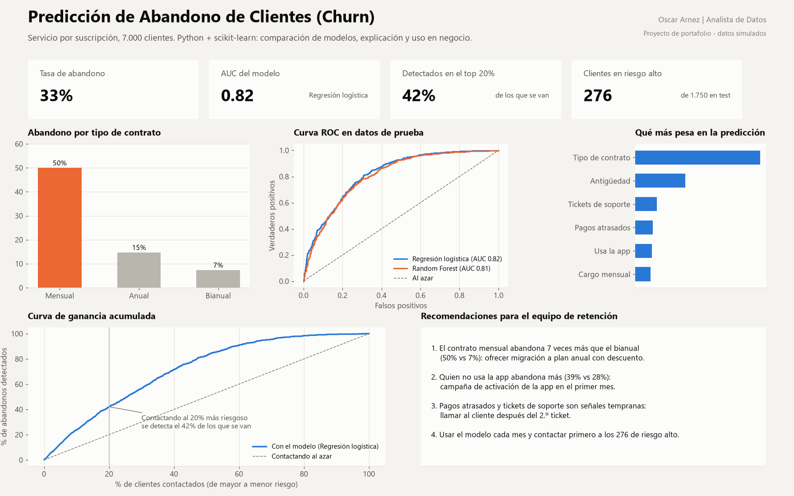

# 05 · Predicción de Abandono de Clientes (Churn) con Machine Learning

> **Pregunta de negocio:** ¿qué clientes tienen más probabilidad de darse de baja el próximo mes y a quiénes
> debería llamar primero el equipo de retención?



## Contexto

Un servicio por suscripción (internet/TV) pierde 1 de cada 3 clientes. El equipo de retención no puede llamar a todos,
así que necesita una **lista priorizada** y saber **por qué** se van. El proyecto cubre el ciclo completo: análisis
exploratorio, comparación de modelos con validación cruzada, explicación del modelo y traducción del resultado a una
decisión de negocio.

## Datos

`data/clientes_suscripcion.csv`: 7.000 clientes y 10 variables, más la columna objetivo `abandono`.

| Variable | Tipo |
|---|---|
| tipo_contrato (Mensual / Anual / Bianual), plan, metodo_pago, region | categórica |
| antiguedad_meses, cargo_mensual, tickets_soporte_90d, pagos_atrasados_12m, usa_app | numérica |

Datos **simulados** con `src/generar_datos.py`. Los efectos de cada variable sobre la baja se definieron por diseño, así que se puede **verificar que el modelo encuentra los factores correctos** (y los encuentra).

## Enfoque

1. **Preprocesamiento en un `Pipeline`**: One-Hot para las variables categóricas y estandarización para las numéricas. Así se evita la fuga de datos entre el entrenamiento y la prueba.
2. **Partición estratificada**: 75% para entrenar y 25% para la prueba final, que el modelo no ve durante el ajuste.
3. **Dos modelos comparados con validación cruzada de 5 pliegues**:

| Modelo | AUC validación cruzada | AUC test | Abandonos detectados en el 20% más riesgoso |
|---|---|---|---|
| **Regresión logística** | **0,807 ± 0,018** | **0,820** | **42%** |
| Random Forest | 0,795 ± 0,016 | 0,808 | 40% |

   Se elige la **regresión logística**: rinde igual o mejor, y además es más simple y más fácil de explicar a gerencia.
4. **Explicabilidad**: importancia por permutación sobre los datos de prueba (cuánto cae el AUC al desordenar cada variable).
5. **Uso en negocio**: curva de ganancia acumulada y lista `outputs/clientes_alto_riesgo.csv` con los clientes de probabilidad mayor a 0,6, ordenados.

## Resultados

- **Factores con más peso:** tipo de contrato, antigüedad, tickets de soporte, pagos atrasados y uso de la app.
- **Contrato mensual: 50% de abandono**, frente a 15% en el anual y 7% en el bianual.
- **Quien no usa la app abandona más:** 39% frente a 28%.
- **Pago en efectivo: 43% de abandono**, frente a 27% con débito automático.
- **Contactar al 20% más riesgoso permite detectar el 42% de los que se van**, el doble que llamando al azar.

## Recomendaciones

1. Ofrecer **migrar del contrato mensual al anual** con un descuento: es el factor de mayor peso.
2. Hacer una **campaña de activación de la app** en el primer mes de cada cliente.
3. Usar el **segundo ticket de soporte** y el **primer pago atrasado** como alertas tempranas para llamar al cliente.
4. Promover el **débito automático**, que además reduce los atrasos.
5. Correr el modelo cada mes y trabajar la lista de **276 clientes de riesgo alto** (sobre 1.750 en la muestra de prueba).

## Cómo ejecutarlo

```bash
pip install -r ../requirements.txt
python src/generar_datos.py
python src/modelo.py
```

**Tecnologías:** Python · scikit-learn (Pipeline, ColumnTransformer, LogisticRegression, RandomForest, validación cruzada, permutation importance) · Pandas · Matplotlib
