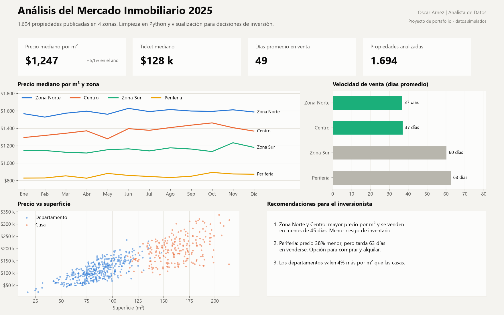

# 06 · Análisis del Mercado Inmobiliario para Inversionistas

> **Pregunta de negocio:** ¿en qué zona conviene invertir según el precio por m², la velocidad de venta y el tipo de inmueble?



## Contexto

Un inversionista evalúa comprar propiedades en 4 zonas de una ciudad. Necesita comparar **precio de entrada** y
**liquidez** (cuánto tarda en venderse una propiedad) y entender cómo evolucionaron los precios durante el año.
El proyecto se basa en el tipo de trabajo que hice para una startup inmobiliaria: estructurar publicaciones de inmuebles y
convertirlas en indicadores para decidir.

## Datos

`data/inmuebles_2025.csv`: 1.694 publicaciones con zona, tipo (departamento o casa), superficie, precio por m², precio y días publicada.
Son datos **simulados**: `src/analisis.py` los genera si no existen.

## Enfoque

1. **Medianas en lugar de promedios** para los precios, porque son robustas frente a propiedades de lujo que distorsionan el promedio.
2. Evolución mensual del precio mediano por m² en cada zona.
3. Días promedio en venta por zona, como medida de liquidez.
4. Precio contra superficie por tipo de inmueble.

## Resultados

| Indicador | Valor |
|---|---|
| Precio mediano por m² | $1.247 (+5,1% en el año) |
| Ticket mediano | $128.000 |
| Días promedio en venta | 49 |
| Zonas de venta rápida (menos de 45 días) | Zona Norte y Centro |

Detalle por zona en `outputs/resumen_zonas.csv`.

## Recomendaciones

1. **Zona Norte y Centro** tienen el precio por m² más alto, pero se venden en menos de 45 días: menor riesgo de quedarse con la propiedad sin vender.
2. **Periferia** cuesta 37% menos por m², pero tarda 63 días en venderse. Funciona mejor para **comprar y alquilar** que para revender rápido.
3. Los **departamentos valen 4% más por m²** que las casas.

## Cómo ejecutarlo

```bash
pip install -r ../requirements.txt
python src/analisis.py
```

**Tecnologías:** Python · Pandas · Matplotlib
