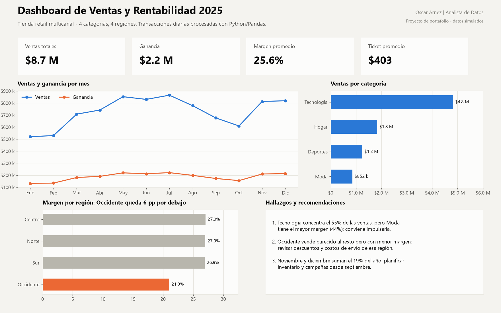
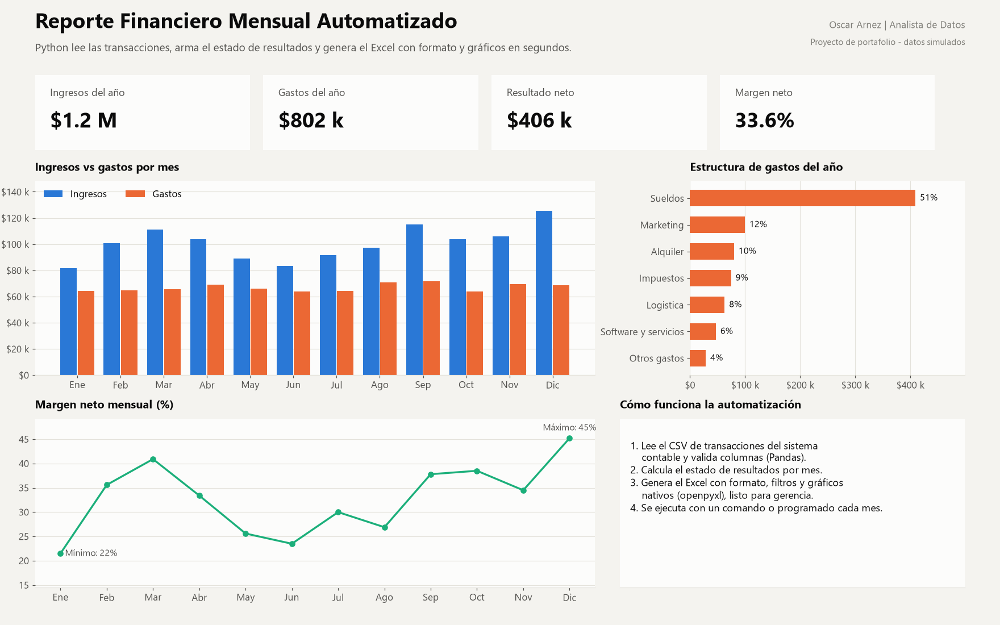
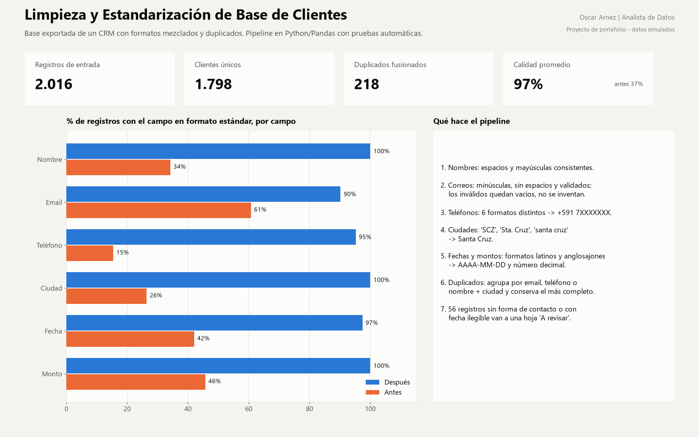
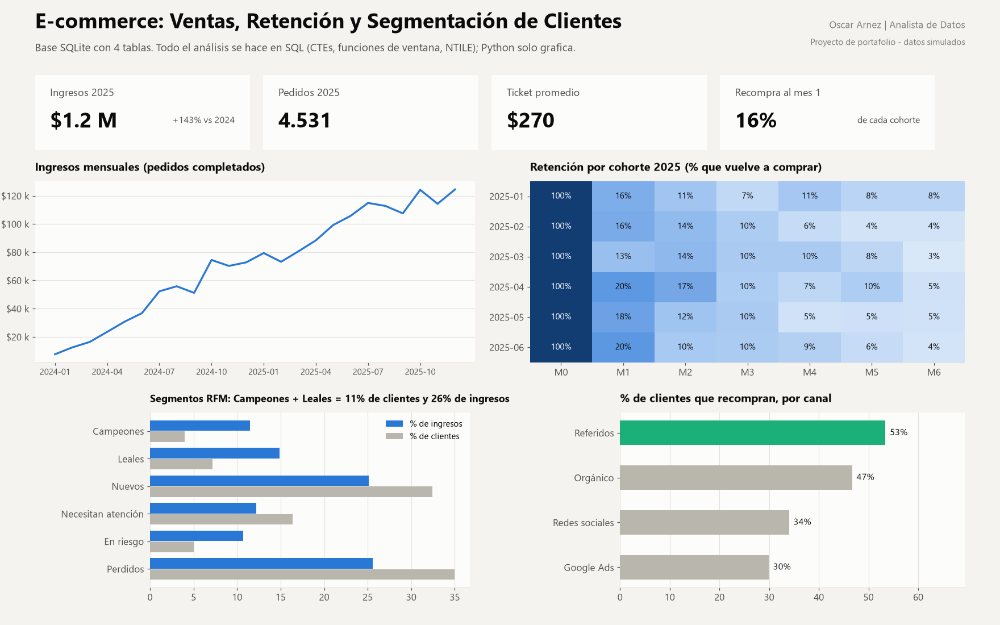
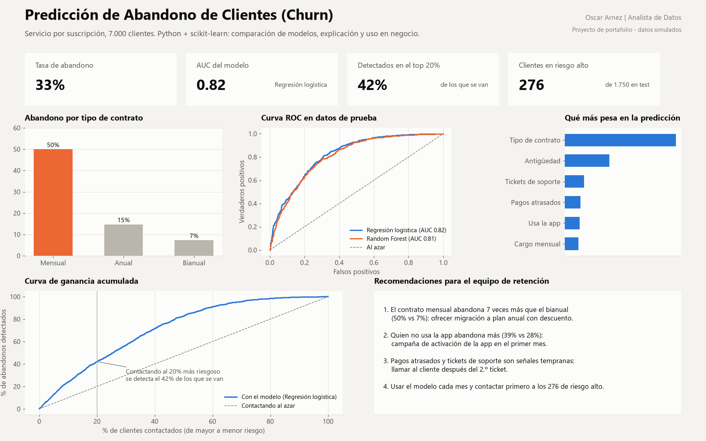
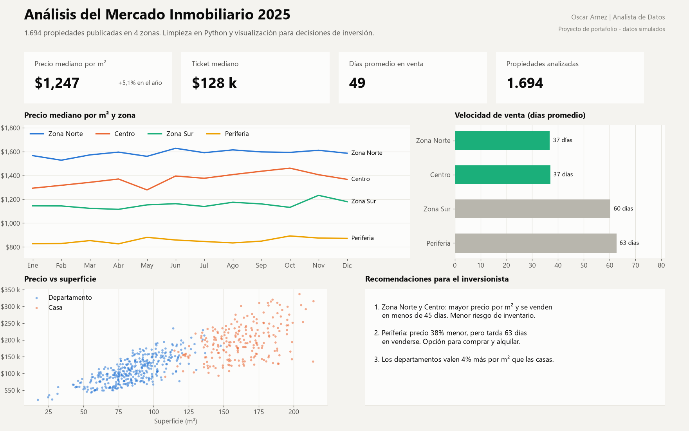

# Portafolio de Análisis de Datos · Oscar Arnez Loayza

**Analista de Datos | Python · SQL · Power BI · Tableau · Excel**

[](https://github.com/Sub-Cre/portafolio-analisis-datos/actions/workflows/ci.yml)


Convierto datos en decisiones: limpio y ordeno bases, construyo dashboards, automatizo reportes que hoy se hacen a mano
y explico los hallazgos en lenguaje de negocio. Cada proyecto de este repositorio parte de una **pregunta de negocio** y
termina en **recomendaciones concretas**, con código reproducible.

**Página profesional:** [sub-cre.github.io](https://sub-cre.github.io) · [LinkedIn](https://www.linkedin.com/in/oscar-a-639b09183)

---

## Proyectos

| # | Proyecto | Pregunta de negocio | Herramientas |
|---|---|---|---|
| 01 | [**Dashboard de ventas y rentabilidad**](01-dashboard-ventas-retail) | ¿Qué categorías y regiones generan la ganancia y dónde se pierde margen? | Python, Pandas, Matplotlib |
| 02 | [**Reporte financiero automatizado**](02-reporte-financiero-automatizado) | ¿Cómo dejar de armar a mano el estado de resultados mensual en Excel? | Python, openpyxl, CLI |
| 03 | [**Limpieza de base de clientes**](03-limpieza-base-clientes) | ¿Cómo dejar una base del CRM sin duplicados y con formatos estándar? | Pandas, regex, pytest |
| 04 | [**Análisis SQL de un e-commerce**](04-analisis-sql-ecommerce) | ¿Los clientes vuelven? ¿Quiénes son los más valiosos? | SQL, CTEs, funciones de ventana |
| 05 | [**Predicción de abandono (churn)**](05-prediccion-abandono-clientes) | ¿A qué clientes debe llamar primero el equipo de retención? | scikit-learn, Machine Learning |
| 06 | [**Mercado inmobiliario**](06-mercado-inmobiliario) | ¿En qué zona conviene invertir según precio y liquidez? | Python, Pandas |

**Proyecto adicional:** [Predicción de precios de vuelos](https://github.com/Sub-Cre/Flight-Price-Predictor-Bangladesh-ML-Model), un modelo de regresión que estima tarifas aéreas según temporada, clase y ruta.

### Vista previa

| | |
|---|---|
|  |  |
|  |  |
|  |  |

## Resultados destacados

- **Limpieza de datos:** la calidad de la base de clientes pasó de **37% a 97%** y se fusionaron 218 duplicados. El pipeline tiene 37 pruebas automáticas.
- **SQL:** el 11% de los clientes (Campeones y Leales) genera el **26% de los ingresos**. Los clientes referidos recompran casi el **doble** que los de Google Ads.
- **Machine Learning:** el modelo de abandono tiene un **AUC de 0,82**. Contactando al 20% de clientes con más riesgo se detecta el **42%** de los que se van.
- **Automatización:** el reporte financiero anual en Excel, con formato y gráficos, se genera con **un solo comando**.

## Cómo ejecutar los proyectos

```bash
git clone https://github.com/Sub-Cre/portafolio-analisis-datos.git
cd portafolio-analisis-datos
pip install -r requirements.txt

cd 03-limpieza-base-clientes
python src/generar_datos.py
python src/pipeline.py
pytest tests -q
```

Cada carpeta tiene su propio `README.md` con el contexto, el enfoque, los resultados y los comandos.
Todos los proyectos se ejecutan automáticamente en **GitHub Actions** con cada cambio, para comprobar que el código funciona.

## Sobre los datos

Los datos son **simulados** y reproducibles, generados con semillas fijas, para poder publicar el código completo sin exponer información de clientes reales.
Las simulaciones incluyen patrones realistas (estacionalidad, duplicados, distintas tasas de recompra por canal) para que el análisis tenga algo que descubrir. Con datos reales el método es el mismo.

## Sobre mí

Analista de datos e ingeniero industrial (Bolivia). Trabajé de forma remota para **NORA** (startup inmobiliaria, Colombia),
con dashboards en Power BI, y para **DataKind** (ONG internacional de ciencia de datos, EE. UU.), con análisis en Python y Tableau.
En **YPFB** automaticé procesos con Python y Excel. Tengo el certificado **Google Advanced Data Analytics** y doy clases de Python en Algorithmics.

**Contacto:** [LinkedIn](https://www.linkedin.com/in/oscar-a-639b09183) · [Página profesional](https://sub-cre.github.io)
